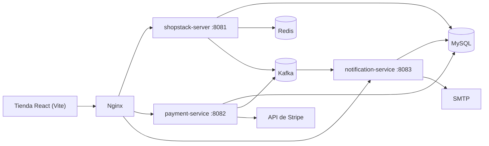

# Shopstack

[English](README.md) · **Español**

Una plataforma de comercio electrónico construida como microservicios: un núcleo Spring Boot
(catálogo, usuarios, carrito, pedidos), un servicio de pagos con Stripe, un servicio de
notificaciones y una tienda en React. Los servicios se comunican por Kafka, persisten en MySQL y
cachean en Redis; el entorno de desarrollo corre detrás de Nginx.

## Contenido

- [Qué hace](#qué-hace)
- [Arquitectura](#arquitectura)
- [Servicios](#servicios)
- [Inicio rápido](#inicio-rápido)
- [Desarrollo local](#desarrollo-local)
- [Pruebas](#pruebas)
- [Tecnologías](#tecnologías)
- [Estructura del repositorio](#estructura-del-repositorio)
- [Notas de seguridad](#notas-de-seguridad)
- [Limitaciones conocidas](#limitaciones-conocidas)
- [Licencia](#licencia)

## Qué hace

**Tienda**

- Catálogo con categorías, fotos y búsqueda.
- Carrito y compra para clientes autenticados.
- Historial de pedidos y estado de cada uno.
- Registro, inicio de sesión y refresco de tokens.
- Tres idiomas de interfaz (inglés, rumano y ruso) y tema claro/oscuro.

**Vendedores y personal**

- Gestión de productos: crear, editar y borrar los productos propios.
- Visibilidad de los pedidos de sus productos.
- Estado del pago por pedido.

**Plataforma**

- Pagos con Stripe e idempotencia por intento.
- Outbox transaccional para no perder eventos de pago ni notificaciones.
- Notificaciones por email vía SMTP (en local es solo un registro).

## Arquitectura



Las peticiones entran por Nginx, que enruta `/api/` al servicio núcleo y mantiene la tienda en el
mismo origen. El núcleo gestiona la autenticación con JWT firmados y refresh rotatorio; el pago y
las notificaciones son asíncronos, con Kafka transportando eventos de dominio y MySQL guardando un
outbox para que una caída no pierda un evento de pago.

## Servicios

| Servicio | Puerto | Responsabilidad |
|---|---|---|
| `shopstack-server` | 8081 | Usuarios, autenticación, productos, categorías, carrito, pedidos |
| `shopstack-payment-service` | 8082 | Pagos con Stripe, estado del pago, idempotencia |
| `shopstack-notification-service` | 8083 | Notificaciones por email a partir de eventos |
| `shopstack-ui` | 8080 (nginx) | Tienda en React con Vite |

Infraestructura: MySQL 8, Kafka (KRaft), Redis 7 y Nginx, definidos en
`development/docker-compose.yml`.

## Inicio rápido

```bash
cd development
cp .env.example .env            # completa los cuatro secretos obligatorios
docker compose up --build
```

La tienda queda en `http://localhost`. El compose expone MySQL, Kafka y Redis para depurar en local,
y Nginx aplica límites de peticiones a las rutas de la API.

El stack no arranca hasta que estos secretos estén definidos (ver `development/.env.example`):

| Variable | Servicio |
|---|---|
| `JWT_SECRET` | servicio núcleo (firma de tokens) |
| `STRIPE_API_KEY` | servicio de pagos |
| `MAIL_HOST`, `MAIL_PORT`, `MAIL_USERNAME`, `MAIL_PASSWORD` | servicio de notificaciones |

## Desarrollo local

```bash
# solo infraestructura
cd development && docker compose up mysql kafka redis

# servicios
cd shopstack-server && mvn spring-boot:run
cd shopstack-payment-service && mvn spring-boot:run
cd shopstack-notification-service && mvn spring-boot:run

# tienda
cd shopstack-ui && npm ci && npm run dev
```

Requiere Java 21+ y Node 20+. Cada servicio tiene su esquema (`shopstack`,
`shopstack_payment_service`, `shopstack_notification_service`) y aplica migraciones Flyway al
arrancar.

## Pruebas

```bash
# backend: 199 pruebas unitarias entre los tres servicios
mvn test

# pruebas y build de producción de la tienda
cd shopstack-ui && npm ci && npm test -- --watchAll=false && npm run build
```

El módulo `shopstack-it` contiene pruebas de integración de caja negra con Testcontainers (MySQL,
Kafka y Redis) y RestAssured. Arrancan el servicio real, así que necesitan Docker pero no un stack
externo:

```bash
mvn -B -pl shopstack-it -am test
```

## Tecnologías

| Área | Tecnologías |
|---|---|
| Backend | Java 21, Spring Boot 3.5, Spring Security, Spring Data JPA, Flyway, Kafka, Redis, MySQL 8 |
| Pagos | SDK de Stripe, claves de idempotencia, outbox transaccional |
| Frontend | React 18, TypeScript, Vite, MUI, Redux Toolkit, diccionarios de i18n |
| Entrega | Docker Compose, Nginx, GitHub Actions |

## Estructura del repositorio

```
shopstack-server/              API núcleo: usuarios, productos, carrito, pedidos
shopstack-payment-service/     pagos con Stripe y outbox
shopstack-notification-service/ notificaciones por email
shopstack-ui/                  tienda en React
shopstack-it/                  pruebas de integración con Testcontainers
development/                   Docker Compose, Nginx y arranque de MySQL
```

## Notas de seguridad

- Las contraseñas se hashean con BCrypt; los access tokens son JWT de vida corta y los refresh
  rotan.
- Cada intento de pago lleva clave de idempotencia, así que un reintento no cobra dos veces.
- La API solo se expone a través de Nginx, y los servicios escuchan dentro de la red de Compose.
- Los secretos vienen de variables de entorno; los valores de ejemplo del compose son marcadores.

## Limitaciones conocidas

- El UI mantiene un aviso alto en la línea de servidor de desarrollo de Vite y dos moderados en
  `react-router`; ambos requieren saltos mayores (Vite 7 y React Router 7).
- El email usa credenciales SMTP en variables de entorno planas.
- No hay índice de búsqueda de productos; la búsqueda va contra MySQL.

## Licencia

MIT. Ver [LICENSE.md](LICENSE.md).
