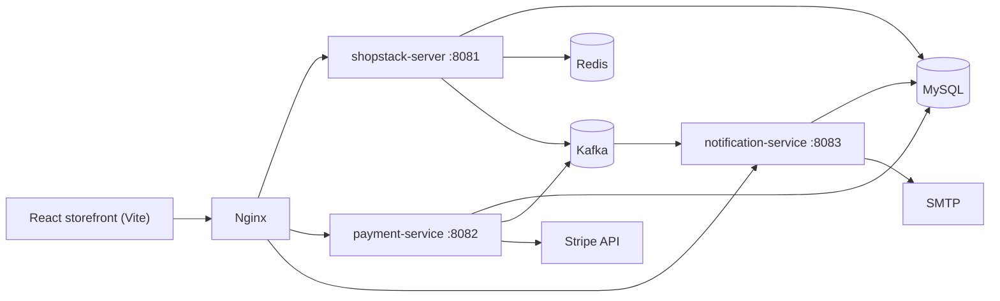

# Shopstack

[English](README.md) · [Español](README.es.md)

An e-commerce platform built as microservices: a Spring Boot core (catalogue, users, cart, orders),
a payment service backed by Stripe, a notification service, and a React storefront. Services talk
over Kafka, persist to MySQL and cache in Redis; the development stack runs behind Nginx.

## Contents

- [What it does](#what-it-does)
- [Architecture](#architecture)
- [Services](#services)
- [Quick start](#quick-start)
- [Local development](#local-development)
- [Testing](#testing)
- [Tech stack](#tech-stack)
- [Repository layout](#repository-layout)
- [Security notes](#security-notes)
- [Known limitations](#known-limitations)
- [License](#license)

## What it does

**Storefront**

- Catalogue with categories, photos and search.
- Cart and checkout for signed-in customers.
- Order history and order status.
- Account registration, sign-in and token refresh.
- Three interface languages (English, Romanian and Russian) and a light/dark theme.

**Sellers and staff**

- Product management: create, edit and delete a seller's own products.
- Order visibility for the seller's products.
- Payment status per order.

**Platform**

- Stripe payment intents with an idempotency key per attempt.
- Transactional outbox so payment and notification events are never lost.
- Email notifications through SMTP (a logging seam in local development).

## Architecture



A request enters through Nginx, which routes `/api/` calls to the core service and keeps the
storefront behind the same origin. The core service handles authentication with signed JWTs and
rotating refresh tokens; payment and notification work is asynchronous, with Kafka carrying domain
events and MySQL holding an outbox so a crash cannot lose a payment event.

## Services

| Service | Port | Responsibility |
|---|---|---|
| `shopstack-server` | 8081 | Users, authentication, products, categories, cart, orders |
| `shopstack-payment-service` | 8082 | Stripe payment intents, payment state, idempotency |
| `shopstack-notification-service` | 8083 | Email notifications from order and payment events |
| `shopstack-ui` | 8080 (nginx) | React storefront with Vite |

Infrastructure: MySQL 8, Kafka (KRaft), Redis 7 and Nginx, all defined in
`development/docker-compose.yml`.

## Quick start

```bash
cd development
cp .env.example .env            # fill in the four required secrets
docker compose up --build
```

The storefront is served at `http://localhost`. The compose file exposes the MySQL, Kafka and Redis
ports for local debugging, and Nginx applies rate limits to the API routes.

The stack refuses to start until these secrets are set (see `development/.env.example`):

| Variable | Used by |
|---|---|
| `JWT_SECRET` | core service (token signing) |
| `STRIPE_API_KEY` | payment service |
| `MAIL_HOST`, `MAIL_PORT`, `MAIL_USERNAME`, `MAIL_PASSWORD` | notification service |

## Local development

```bash
# infrastructure only
cd development && docker compose up mysql kafka redis

# core service and friends
cd shopstack-server && mvn spring-boot:run
cd shopstack-payment-service && mvn spring-boot:run
cd shopstack-notification-service && mvn spring-boot:run

# storefront
cd shopstack-ui && npm ci && npm run dev
```

Java 21+ and Node 20+ are required. Each service owns its schema
(`shopstack`, `shopstack_payment_service`, `shopstack_notification_service`) and applies Flyway
migrations on start.

## Testing

```bash
# backend: 199 unit tests across the three services
mvn test

# storefront tests and production build
cd shopstack-ui && npm ci && npm test -- --watchAll=false && npm run build
```

The `shopstack-it` module holds black-box integration tests built with Testcontainers (MySQL,
Kafka and Redis) and RestAssured. They boot the real service, so they need Docker but no external
stack:

```bash
mvn -B -pl shopstack-it -am test
```

## Tech stack

| Area | Technologies |
|---|---|
| Backend | Java 21, Spring Boot 3.5, Spring Security, Spring Data JPA, Flyway, Kafka, Redis, MySQL 8 |
| Payments | Stripe Java SDK, idempotency keys, transactional outbox |
| Frontend | React 18, TypeScript, Vite, MUI, Redux Toolkit, i18next-style dictionaries |
| Delivery | Docker Compose, Nginx, GitHub Actions |

## Repository layout

```
shopstack-server/              core API: users, products, cart, orders
shopstack-payment-service/     Stripe payments and outbox
shopstack-notification-service/ email notifications
shopstack-ui/                  React storefront
shopstack-it/                  Testcontainers integration tests
development/                   Docker Compose, Nginx and MySQL bootstrap
```

## Security notes

- Passwords are hashed with BCrypt; access tokens are short-lived JWTs and refresh tokens rotate.
- Every payment attempt carries an idempotency key, so retries cannot charge twice.
- The API is only exposed through Nginx, and the services bind inside the Compose network.
- Secrets come from environment variables; the sample values in the Compose file are placeholders.

## Known limitations

- The UI still carries a high advisory in the Vite dev-server line and two moderate ones in
  `react-router`; both fixes require major upgrades (Vite 7 and React Router 7).
- Email uses SMTP credentials in plain environment variables.
- There is no product search index; search runs against MySQL.

## License

MIT. See [LICENSE.md](LICENSE.md).
